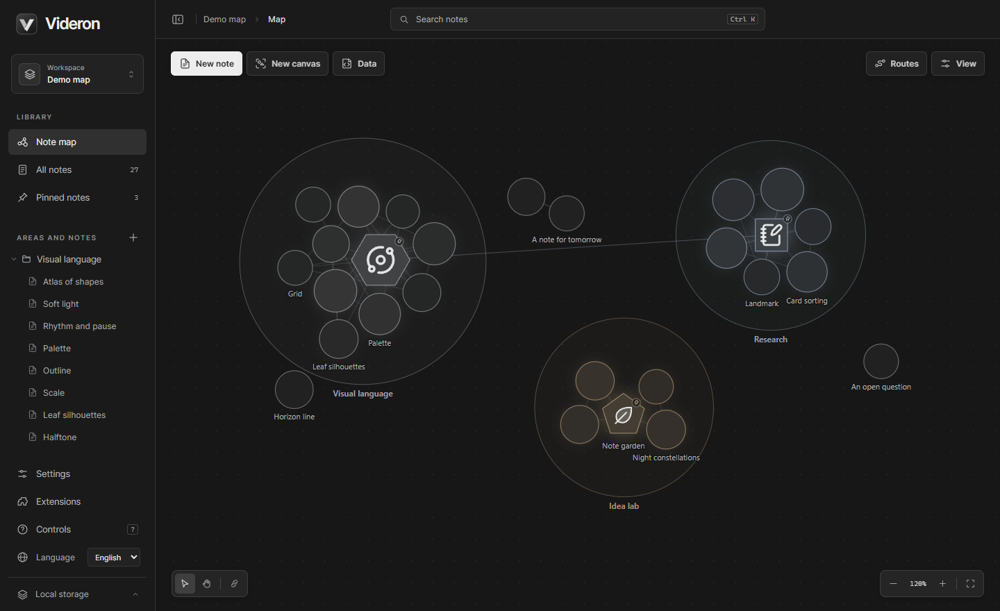

# Videron

**English** · [Русский](README.ru.md)

Videron is a local-first desktop app for keeping notes on a map. The size of each circle reflects how much it holds, and its glow shows how often you open it. Give two notes the same tag to link them. Zoom in to read a preview, or save a route through several notes to revisit them in order.



[Download for Windows](https://github.com/JordexDef/Videron/releases/download/v0.47.0/Videron-0.47.exe) · [Build for macOS](#build-the-desktop-app) · [All releases](https://github.com/JordexDef/Videron/releases)

## Working with notes

- **Arrange your map.** Drag notes into nested areas, pin them to a grid, or move them between stages of a project. The sidebar shows the same areas as a folder tree.
- **Write and draw.** Embed a sketch, image, code block, or table with formulas in a text note. Use a canvas note when you want to arrange those elements freely.
- **Work with data.** Open JSON, CSV, or TSV in a data note. For CSV and TSV, switch to the table view to sort by a column or remove duplicates using the fields you choose.
- **Keep your notes offline.** Protect an individual note or an entire space with a password. To use the same projects on multiple computers, connect them to your own Videron Sync server.

On first launch, choose **English** from the language selector at the bottom of the sidebar. Select **Explore the demo** to open the example map in its own space.

## Build the desktop app

Install Go 1.26.11 or later. Windows needs the Microsoft Edge WebView2 Runtime. On macOS, install the Xcode Command Line Tools with `xcode-select --install` if you don't already have them.

Run the following command from the directory containing `go.mod`. Go downloads Wails and its dependencies on the first build. The frontend, fonts, and icons are included in the repository.

```sh
go run github.com/wailsapp/wails/v2/cmd/wails@v2.17.1 build -s -skipbindings -trimpath
```

| System | Launch the app |
| --- | --- |
| Windows · PowerShell | `.\build\bin\Videron.exe` |
| macOS · Terminal | `open build/bin/Videron.app` |

Version 0.47 has been tested on Windows. The macOS build still needs verification.

## Run your own sync server

Videron Sync is a separate program that can run on a home server or a VPS. Connected devices receive updates as you work. When an offline device reconnects, it fetches the changes it missed. If two devices edited the same note, you can compare the versions and choose what to keep.

To build the server on Linux, run this command from the repository root. It places the binary next to the installer.

```sh
go build -trimpath -o deploy/linux/videron-sync ./cmd/videron-sync
```

The installer asks you to set a server password the first time you run it. [Server setup, backups, and updates](docs/server-setup.md)

## User guide

For keyboard shortcuts, map routes, table formulas, encryption, and the extension API, see the [Videron user guide](docs/guide.md).
