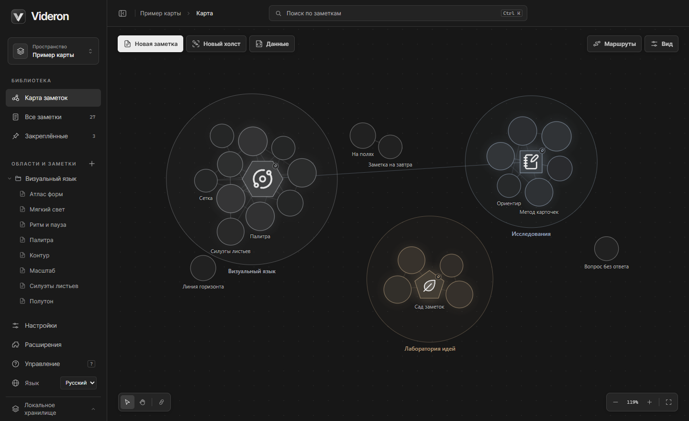

# Videron

[English](README.md) · **Русский**

В Videron у каждой заметки есть место на карте. Размер круга показывает объём записи, а мягкое свечение — как часто вы её открываете. Общий тег связывает заметки. Приблизьте карту, чтобы прочитать фрагмент, или соберите несколько записей в маршрут и пройдите их по порядку.



[Скачать для Windows](https://github.com/JordexDef/Videron/releases/download/v0.48.0/Videron-0.48.exe) · [Собрать на Mac](#сборка-приложения) · [Все сборки](https://github.com/JordexDef/Videron/releases)

## Что можно делать

- **Собирать карту.** Перетаскивайте заметки в области, закрепляйте их на сетке или перемещайте между этапами работы. Вложенные области также видны как папки в боковой панели.
- **Писать и рисовать.** В текстовую заметку можно вставить рисунок, картинку, код или таблицу с формулами. Заметка-холст позволяет свободно расположить те же материалы рядом.
- **Работать с данными.** Открывайте JSON, CSV и TSV в редакторе данных. Для CSV и TSV можно переключиться на таблицу, отсортировать строки по столбцу и удалить дубликаты по выбранным полям.
- **Работать офлайн.** Создание, редактирование и поиск заметок доступны локально. Пространство можно синхронизировать, когда оно понадобится на другом компьютере.

Чтобы попробовать карту после запуска, нажмите **Посмотреть пример**. Демонстрационная карта откроется в отдельном пространстве. Интерфейс доступен на русском и английском.

## Шифрование

- **Одна заметка.** Нажмите на замок в редакторе и задайте пароль. Он защищает название, текст, теги и вложения. На карте видны положение заметки, её область и ручные связи. Заметка с отдельным паролем исключена из общего поиска, даже когда открыта в редакторе.
- **Локальная библиотека.** Выберите **Настройки → Шифрование библиотеки → Задать пароль**, чтобы защитить файл библиотеки на этом компьютере. У каждого пространства в отдельной папке своя настройка шифрования.
- **Папка или проект для синхронизации.** При создании выберите **Зашифровать пространство**. Videron шифрует заметки, вложения и историю версий на устройстве до отправки. Если пространство изначально хранилось без шифрования, после установки пароля на отдельную заметку её прежние открытые версии останутся доступными в папке, на сервере и в резервных копиях.

Videron шифрует данные алгоритмом AES-256-GCM, а ключ получает из пароля с помощью Argon2id. После разблокировки пространства поиск по нему работает локально. Откройте **Настройки → Автоблокировка**, чтобы задать время бездействия или выбрать **Только при новой сессии**. При блокировке Windows приложение сохраняет правки и блокирует открытые защищённые данные. [Подробнее о шифровании](docs/guide.ru.md#шифрование)

## Синхронизация между компьютерами

- **Свой сервер.** В меню пространств выберите **Свой сервер…**, введите адрес и пароль сервера, затем выберите проект. Откройте тот же проект на втором компьютере. Videron создаст локальную рабочую копию автоматически. Нажмите на статус внизу боковой панели, чтобы увидеть состояние соединения и время последней успешной синхронизации.
- **Папка в облаке.** Создайте пространство в папке, которую синхронизирует ваш облачный диск. Синхронизируйте папку целиком, включая скрытый каталог `.videron-sync`. На втором компьютере выберите **Открыть из папки…** в меню пространств.

В обоих случаях можно работать офлайн. Изменения в разных заметках объединяются автоматически. Если одну заметку изменили на обоих компьютерах или на одном её удалили, а на другом отредактировали, Videron покажет обе версии и предложит выбрать, что оставить. При работе через Videron Sync подключённые клиенты получают уведомления об изменениях, а после восстановления связи обмениваются недостающими версиями.

Пароль сервера даёт доступ к его проектам. Если пространство без шифрования, обычные заметки можно прочитать в хранилище сервера. Для зашифрованного проекта на каждом компьютере введите пароль, заданный при создании пространства. Содержимое и история такого проекта хранятся на сервере в зашифрованном виде. Серверу видны названия проектов, размеры файлов и время загрузки. [Как подключить два компьютера](docs/server-setup.ru.md#подключение-двух-компьютеров)

## Сборка приложения

Понадобится Go 1.26.11 или новее. В Windows для запуска нужен Microsoft Edge WebView2 Runtime. На Mac установите Xcode Command Line Tools командой `xcode-select --install`, если их ещё нет.

В каталоге с `go.mod` выполните команду сборки для своей ОС. Go загрузит Wails и зависимости при первом запуске. Интерфейс, шрифты и иконки уже входят в исходники.

```sh
go run github.com/wailsapp/wails/v2/cmd/wails@v2.17.1 build -s -skipbindings -trimpath
```

| Система | Запуск после сборки |
| --- | --- |
| Windows · PowerShell | `.\build\bin\Videron.exe` |
| macOS · Terminal | `open build/bin/Videron.app` |

## Свой сервер

Videron Sync — отдельное приложение, которое может обслуживать несколько проектов на домашней машине или VPS.

Команда собирает сервер на Linux и кладёт его рядом с установщиком.

```sh
go build -trimpath -o deploy/linux/videron-sync ./cmd/videron-sync
```

При первой установке Videron Sync предложит задать пароль для подключения клиентов. [Установка, подключение и резервные копии](docs/server-setup.ru.md)

## Руководство

Горячие клавиши, маршруты, формулы таблиц, шифрование и API расширений описаны в [руководстве Videron](docs/guide.ru.md).
